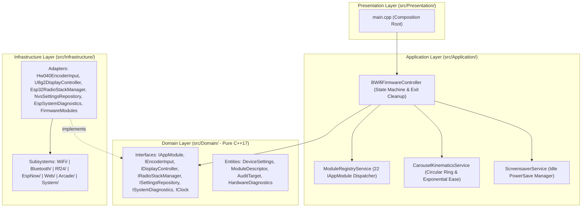
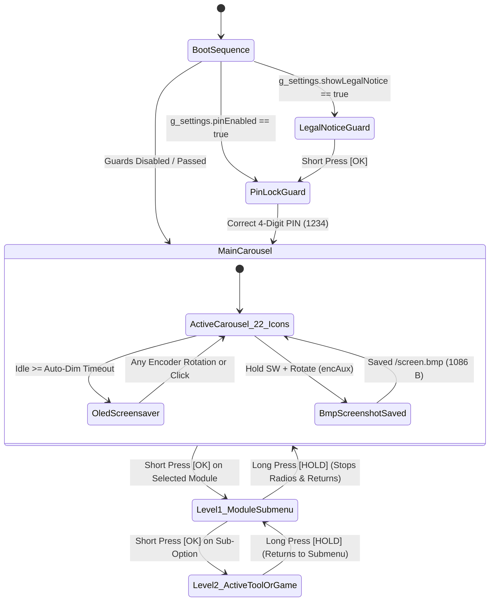

# BWifi-ESP32

**Multi-Tool 2.4 GHz RF Spectrum Analyzer, Defensive WiFi Auditing Suite, BLE Tracker Detector, Composite BLE HID + Ducky Script Engine, ESP-NOW Controller & 10-in-1 Retro Arcade Firmware for ESP32**

[](https://www.espressif.com/en/products/socs/esp32)
[](https://en.cppreference.com/w/cpp/17)
[](#system-architecture)
[](#whats-new-in-v35-v34--v33)
[](https://platformio.org/)
[](https://github.com/olikraus/u8g2)
[](https://nrf24.github.io/RF24/)
[](#05-ble-trackers-srcble_trackerscpp)
[](#rotary-encoder-hw-040-control-system--7-state-automaton)
[](Disclaimer.md)
[](LICENSE)

---

> [!IMPORTANT]
> **LEGAL DISCLAIMER & ETHICAL USE REQUIREMENT (`LAB MODE` ONLY)**  
> **BWifi-ESP32** is developed strictly for **authorized security auditing, academic research, RF spectrum diagnostics, and controlled laboratory environments**. Misuse of active wireless or RF features on networks or devices without prior written authorization may violate local and international telecommunications laws (**FCC**, **RED**, **INDOTEL**, **ITU**).  
> Please read the full **[Legal Disclaimer & Ethical Use Policy (`Disclaimer.md`)](Disclaimer.md)** before building, flashing, or operating this firmware.

---

**BWifi-ESP32 (BWifiKill v3.5)** is a high-performance, modular wireless diagnostics, defensive cybersecurity auditing, RF spectrum visualization, and embedded productivity firmware built for the **Espressif ESP32** (and adaptable to **ESP32-S3**). It combines the ESP32's internal **WiFi (802.11b/g/n)** and **Bluetooth Low Energy (BLE)** transceivers with **two external `nRF24L01+PA+LNA` 2.4 GHz radios** over a 16 MHz hardware SPI bus, rendering a fluid **60+ FPS Bruce-style 3-icon graphical carousel** on a **128×64 SSD1306 I2C OLED display (800 kHz)** driven entirely by a single **Rotary Encoder HW-040 (KY-040)**.

Version **v3.5** expands the firmware to **22 top-level modules** and **over 45 specialized sub-tools**, including passive **Rogue AP / Evil Twin Detection**, **Karma / Pineapple Detection**, **Hidden SSID Unmasking**, **MAC Randomizer Analysis**, **IEEE 802.11 `.pcap` Packet Capture**, **DHCP + NTP Auditing**, **BLE AirTag/SmartTag/Tile Radar with Log-Distance Meter Estimation**, **Composite BLE HID (Keyboard + Mouse + Media + Gamepad) with live-editable Ducky Script (`/payload.txt`)**, **2.4 GHz Waterfall + AI Spectral Fingerprinting + MouseJack ESB Lab**, **OLED `.bmp` Screenshot Capture**, and a **10-in-1 Arcade Console** with persistent NVS leaderboards.

---

## Table of Contents

- [Legal Disclaimer & Ethical Use (`Disclaimer.md`)](#legal-disclaimer--ethical-use-disclaimermd)
- [Features](#features)
- [Key Features](#key-features)
- [What's New in v3.5, v3.4 & v3.3](#whats-new-in-v35-v34--v33)
- [Added Functions & Modules by File](#added-functions--modules-by-file)
- [System Architecture](#system-architecture)
  - [Layered Architecture Diagram](#layered-architecture-diagram)
  - [Navigation State Machine & Hierarchical Submenu Workflow](#navigation-state-machine--hierarchical-submenu-workflow)
  - [Directory Tree](#directory-tree)
- [Hardware Specifications & Step-by-Step Wiring Guide](#hardware-specifications--step-by-step-wiring-guide)
  - [Bill of Materials (BOM)](#bill-of-materials-bom)
  - [Option A: Standard ESP32 DevKit V1 (30/38-Pin) Wiring Step-by-Step](#option-a-standard-esp32-devkit-v1-3038-pin-wiring-step-by-step)
  - [Option B: Seeed Studio XIAO ESP32S3 (11-Pin Compact Build) Wiring](#option-b-seeed-studio-xiao-esp32s3-11-pin-compact-build-wiring)
  - [Step-by-Step Hardware Assembly & Power Decoupling](#step-by-step-hardware-assembly--power-decoupling)
- [Core Algorithms & Mathematical Models](#core-algorithms--mathematical-models)
  - [Deterministic 7-State Gray-Code Quadrature Automaton](#deterministic-7-state-gray-code-quadrature-automaton)
  - [Exponential Decay Carousel Kinematics](#exponential-decay-carousel-kinematics)
  - [BLE Log-Distance Path Loss Distance Estimator](#ble-log-distance-path-loss-distance-estimator)
  - [2.4 GHz Spectral Fingerprinting Classifier](#24-ghz-spectral-fingerprinting-classifier)
  - [1-Bit Monochrome BMP Framebuffer Serializer](#1-bit-monochrome-bmp-framebuffer-serializer)
- [Rotary Encoder HW-040 Control System & API](#rotary-encoder-hw-040-control-system--api)
- [Step-by-Step Operating Guide to All 22 Modules](#step-by-step-operating-guide-to-all-22-modules)
  - [01. WIFI SCANNER (`src/wifiscan.cpp`)](#01-wifi-scanner-srcwifiscancpp)
  - [02. WIFI AUDIT PRO (`src/wifi_tools.cpp`) — 7 Submodes](#02-wifi-audit-pro-srcwifi_toolscpp--7-submodes)
  - [03. ANALIZADOR (`src/spectrograph.cpp`) — 4 RF Views](#03-analizador-srcspectrographcpp--4-rf-views)
  - [04. BT SCANNER (`src/btscan.cpp`)](#04-bt-scanner-srcbtscancpp)
  - [05. BLE TRACKERS (`src/ble_trackers.cpp`) — 3 Submodes](#05-ble-trackers-srcble_trackerscpp--3-submodes)
  - [06. PACKET MONITOR (`src/packet_monitor.cpp`)](#06-packet-monitor-srcpacket_monitorcpp)
  - [07. MODO CENTINELA (`src/centinela.cpp`)](#07-modo-centinela-srccentinelacpp)
  - [08. JAMMER CANAL (`src/jammer.cpp`)](#08-jammer-canal-srcjammercpp)
  - [09. BARRIDO TOTAL (`src/total_jammer.cpp`)](#09-barrido-total-srctotal_jammercpp)
  - [10. BT JAMMER (`src/bt_jammer.cpp`)](#10-bt-jammer-srcbt_jammercpp)
  - [11. BEACON SPAM (`src/beacon_spam.cpp`)](#11-beacon-spam-srcbeacon_spamcpp)
  - [12. BLE SPAM (POP) (`src/ble_spam.cpp`) — 5 Modes](#12-ble-spam-pop-srcble_spamcpp--5-modes)
  - [13. MODO HIBRIDO (`src/hybrid_attack.cpp`)](#13-modo-hibrido-srchybrid_attackcpp)
  - [14. EVIL PORTAL (`src/evil_portal.cpp`)](#14-evil-portal-srcevil_portalcpp)
  - [15. IP SCANNER (`src/ip_scanner.cpp`) — Ping, Port Scan & DHCP/NTP Audit](#15-ip-scanner-srcip_scannercpp--ping-port-scan--dhcpntp-audit)
  - [16. CONTROL ESCLAVO (`src/slave.control.cpp`)](#16-control-esclavo-srcslavecontrolcpp)
  - [17. WEB DASHBOARD (`include/web_server.h`, `src/web_dashboard.cpp`)](#17-web-dashboard-includeweb_serverh-srcweb_dashboardcpp)
  - [18. BT REMOTE (`src/bt_remote.cpp`) — 6 HID Submodes + Ducky Script](#18-bt-remote-srcbt_remotecpp--6-hid-submodes--ducky-script)
  - [19. LEER LOGS (`src/log_viewer.cpp`)](#19-leer-logs-srclog_viewercpp)
  - [20. ARCADE (`src/games_menu.cpp`) — 10-in-1 Retro Console](#20-arcade-srcgames_menucpp--10-in-1-retro-console)
  - [21. AJUSTES / TEST (`src/settings_menu.cpp`) — NVS Settings & Self-Test](#21-ajustes--test-srcsettings_menucpp--nvs-settings--self-test)
  - [22. ABOUT (`src/about_info.cpp`)](#22-about-srcabout_infocpp)
- [Web Dashboard Command Center v3.5 & REST API](#web-dashboard-command-center-v35--rest-api)
  - [HTTP Endpoints Topology](#http-endpoints-topology)
  - [Live JSON Telemetry Payload (`/api/status`)](#live-json-telemetry-payload-apistatus)
  - [Ducky Script Language Reference (`/payload.txt`)](#ducky-script-language-reference-payloadtxt)
- [Step-by-Step Build & Flashing Instructions](#step-by-step-build--flashing-instructions)
  - [Prerequisites](#prerequisites)
  - [Step 1: Clone or Open the Project](#step-1-clone-or-open-the-project)
  - [Step 2: Review `platformio.ini` & Partition Scheme](#step-2-review-platformioini--partition-scheme)
  - [Step 3: Compile the Firmware](#step-3-compile-the-firmware)
  - [Step 4: Flash to ESP32 via PlatformIO or `esptool.py`](#step-4-flash-to-esp32-via-platformio-or-esptoolpy)
  - [Step 5: Verify Hardware with Built-in `SELF-TEST HW`](#step-5-verify-hardware-with-built-in-self-test-hw)
- [Troubleshooting & Diagnostics](#troubleshooting--diagnostics)
- [Roadmap (`v3.3` → `v4.0`)](#roadmap-v33--v40)
- [License](#license)
- [Contact](#contact)
- [Support](#support)

---

## Legal Disclaimer & Ethical Use (`Disclaimer.md`)

All users, researchers, and contributors must adhere to the policies defined in **[`Disclaimer.md`](Disclaimer.md)**:

1. **[Purpose & Intended Scope](Disclaimer.md#1-purpose-and-intended-scope)**: Strictly limited to educational exploration, defensive monitoring, spectrum diagnostics, and authorized laboratory testing (`LAB MODE`).
2. **[Regulatory Compliance](Disclaimer.md#2-regulatory--legal-compliance)**: Compliance with **FCC Part 15**, **EU RED 2014/53/EU**, **INDOTEL Ley No. 153-98**, and **ITU** regulations is mandatory.
3. **[Built-in Firmware Safeguards](Disclaimer.md#3-built-in-hardware--software-safeguards)**: Includes a configurable **Boot Legal Notice (`AVISO LAB`)**, **4-Digit Startup PIN Lock (`1234`)**, **Operating Profile Selector (`LAB / AUDIT / DEMO`)**, and **Hardware Self-Test** stored in non-volatile memory (`NVS`).
4. **[Limitation of Liability](Disclaimer.md#4-limitation-of-liability)**: Provided `"AS IS"` without warranty; the user assumes full legal responsibility for operation.

---

## Features

| Feature | Description |
|---|---|
| **WiFi Defense & Discovery Suite** | 7-in-1 passive auditing engine: **Probe Sniffer + MAC Randomizer Detector**, **Channel Heatmap (`1..13`)**, **Wardriving + Kismet CSV Logger**, **Rogue AP / Evil Twin Detector**, **Hidden SSID Unmasker**, **Karma / Pineapple Detector**, and **`.pcap` Packet Capture (`libpcap`)** |
| **Dual `nRF24L01+` 2.4 GHz Engine** | Parallel scanning and carrier generation across all **125 ISM channels (`2.400–2.525 GHz`)** over 16 MHz hardware SPI (`jam1` on `5/17` covering `ch 0..61`, `jam2` on `16/4` covering `ch 63..124`) |
| **4-View Spectrum Analyzer** | Instant `OK` toggle between **Real-Time Bar Histogram + Peak Hold**, **2D Temporal Waterfall (36×125)**, **AI RF Spectrum Fingerprint Classifier (`WiFi / BLE / Zigbee / ESB`)**, and **MouseJack / ESB Sniffer + Lab Replay** |
| **BLE Anti-Tracking Radar & Distance Meter** | Detects **Apple AirTag / FindMy (`0x004C`)**, **Samsung SmartTag (`0x0075`/`0xFD5A`)**, **Tile (`0xFEED`/`0xFEEC`)**, and **Google Find My (`0xFE2C`)**, computing real-time distance in meters ($d = 10^{(-59-\text{RSSI})/(10 \times 2.2)}$) and logging hits to `/trackers.txt` |
| **iBeacon Transmitter & Multi-OS BLE Advertising** | Real-time configurable **Apple iBeacon Emitter** (`Minor 1..99` via rotary encoder) and 5-mode proximity popup generator (`Apple iOS`, `Windows Swift Pair`, `Android Fast Pair`, `Samsung Galaxy Buds`, `Multi-OS Auto-Cycle`) |
| **Composite BLE HID + Ducky Script Parser** | Single-connection **BLE Keyboard + Media Controller + 5-Action Mouse + Gamepad (`BleComboControl`)** with a built-in **Ducky Script interpreter (`/payload.txt`)** and hot-swappable **Keyboard Layout Selector (`ES` / `EN`)** |
| **LAN IP Scanner + DHCP & NTP Auditor** | Active subnet host discovery (`1..254`) via ICMP Ping, OS/service fingerprinting (`Apple`, `Windows`, `Android/IoT`, `Web/Router`, `NAS`), UDP stress test, **DHCP Gateway/DNS consistency check**, and **UTC NTP clock synchronization** |
| **Web Command Center v3.5** | Asynchronous web server (`ESPAsyncWebServer` on `http://192.168.4.1`) with unique eFuse SSID `BWESP-<ChipID>`, live JSON telemetry (`/api/status`), online **Ducky Script Editor**, **Arcade Leaderboard**, and 1-click downloads for `.pcap`, `.csv`, `.txt`, and `.bmp` OLED screenshots |
| **10-in-1 Retro Arcade Console** | 10 full games tailored for the rotary encoder (`Snake`, `Pong`, `Flappy Bird`, `Space Invaders`, `Dino Run`, `Breakout`, `Simon Memory`, `Tetris`, `Asteroids`, `2048 Puzzle`) with high scores persisted in `NVS` |
| **OLED `.BMP` Screenshot & UI Themes** | Instant 1-bit `128×64` Windows `.bmp` (`1086 bytes`) framebuffer export to `/screen.bmp` via `SW + Rotate` or Settings, plus 3 UI themes (`CLASICO`, `INVERSO`, `RETRO`) |

---

## Key Features

| Subsystem | Technical Implementation | Benefit |
|---|---|---|
| **7-State Gray-Code Encoder Driver** | Deterministic Buxton automaton (`kStateTable[7][4]`) in [`src/encoder_input.cpp`](src/encoder_input.cpp) using direct register reads (`GPIO.in` / `GPIO.in1.val`) in `IRAM_ATTR` ISR | Zero missed steps during heavy WiFi/BLE interrupts; immune to mechanical contact bounce |
| **800 kHz I2C OLED Pipeline** | `U8G2_SSD1306_128X64_NONAME_F_HW_I2C` configured with `u8g2.setBusClock(800000)` and exponential frame interpolation | Reduces full-frame transfer time to ~11 ms, delivering > 60 FPS animations |
| **Hierarchical Back Navigation** | Multi-level state machines across all 22 modules handle `encBack()` (`HOLD >= 500 ms`) by stepping back one level (`Tool -> Submenu -> Main Carousel`) | Eliminates unintended MCU reboots when exiting submenus |
| **Automatic SPIFFS Log Rotation** | `rotateLogIfNeeded(path, 24576)` in [`src/settings_menu.cpp`](src/settings_menu.cpp) rotates `/logins.txt`, `/wardrive.csv`, `/trackers.txt`, and `/capture.pcap` to `.1` backups at 24 KB | Prevents SPIFFS partition exhaustion during multi-hour auditing sessions |
| **NVS Persistent Configuration** | Stored via `Preferences` (`bwifi_cfg` namespace) in [`src/settings_menu.cpp`](src/settings_menu.cpp) | Preserves OLED brightness, encoder direction, screensaver timeout, PIN lock, UI theme, slave MAC status, and all 10 Arcade records across power cycles |

---

## What's New in v3.5, v3.4 & v3.3

### v3.5 Expansion (Defensive WiFi, Ducky Script, RF Fingerprint, 10 Arcade Games & BMP Screenshots)
- **WiFi Defense & Discovery (`src/wifi_tools.cpp`, `src/ip_scanner.cpp`)**:
  - `1. PROBE + MAC RND`: Real-time **MAC Randomizer Detector** inspecting the locally administered bit (`mac[0] & 0x02`) to classify client probes into `[RND]` (privacy randomized) vs `[REAL]` (factory OUI) with live counters.
  - `3. WARDRIVE + KISMET`: Kismet-compatible CSV formatting (`infrastructure`) with real UTC epoch timestamps when synced via NTP.
  - `4. ROGUE AP / EVIL TWIN`: Scans and cross-compares all nearby APs to alert on duplicate SSIDs with different BSSIDs/channels or encryption downgrade (`WPA -> OPEN!`).
  - `5. HIDDEN SSID UNMASK`: Passively correlates hidden Beacon frames (`0x80` with null/zero-length SSID) against `Probe Response` (`0x50`) and `Association Request` (`0x00`) frames to reveal the true SSID (`REVELADO!`).
  - `6. KARMA / PINEAPPLE`: Detects rogue APs responding to $\ge 3$ distinct SSIDs from the same BSSID.
  - `7. PCAP CAPTURE (.pcap)`: Captures raw 802.11 management frames into `/capture.pcap` (`libpcap` magic `0xA1B2C3D4`, linktype `105`) downloadable from the Web Dashboard.
  - `4. DHCP AUDIT + NTP` (in `IP SCANNER`): Validates Gateway vs. DNS server assignment and synchronizes real UTC time via `pool.ntp.org`.
- **BLE Distance Meter & Ducky Script HID (`src/ble_trackers.cpp`, `src/bt_remote.cpp`)**:
  - Added log-distance path loss estimation in meters (`estimateBleDistanceMeters()`) inside `1. DETECTOR AIRTAG/TILE` and a dedicated `3. MEDIDOR DISTANCIA (m)` submode.
  - Added **`4. DUCKY (/payload.txt)`** interpreter (`DELAY`, `STRING`, `ENTER`, `GUI`, `TAB`, `UP`, `DOWN`, `SPACE`, `REM`), **`5. LAYOUT TECLADO: ES/EN`**, and **`6. BLE GAMEPAD / STICK`**.
- **RF Spectrum Fingerprint & MouseJack ESB Lab (`src/spectrograph.cpp`)**:
  - Added View 2 (**`RF FINGERPRINT IA`**) and View 3 (**`MOUSEJACK / ESB LAB`**) to the 125-channel 2.4 GHz analyzer.
- **10-in-1 Arcade, BMP Screenshot & Themes (`src/games_menu.cpp`, `src/settings_menu.cpp`, `include/web_server.h`)**:
  - Added **`8. TETRIS`**, **`9. ASTEROIDS`**, and **`10. 2048 PUZZLE`**.
  - Added **`saveOledScreenshotBmp("/screen.bmp")`** (`SW + Rotate` shortcut on main menu, Settings option `8`, and `/download-screen` web button) + **`7. TEMA UI: CLASICO / INVERSO / RETRO`**.

### v3.4 & v3.3 Foundations
- **v3.4**: Introduced `WIFI AUDIT PRO` (`Probe Sniffer`, `Channel Heatmap`, `Wardriving CSV`), `BLE TRACKERS` (`AirTag/Tile/SmartTag Detector` + `iBeacon Emitter`), 5-mode `BLE SPAM`, Composite `BleComboControl` HID Mouse, 2D `WATERFALL` spectrum view, `AJUSTES / TEST` NVS menu with `SELF-TEST HW`, and `Breakout` + `Simon`.
- **v3.3**: Complete migration to the **HW-040 Rotary Encoder** with 7-state Gray-code state machine, 800 kHz 3-icon carousel, hierarchical non-rebooting submenu exit, and dynamic `BWESP-<ChipID>` SoftAP.

---

## Added Functions & Modules by File

### 1. Input, UI Carousel & System Core (`src/main.cpp`, `src/encoder_input.cpp`, `src/gui_helper.cpp`, `src/settings_menu.cpp`)
- [`include/encoder_input.h`](include/encoder_input.h) & [`src/encoder_input.cpp`](src/encoder_input.cpp):
  - `encoderInit()`, `encoderUpdate()`, `encClear()`, `readPinFast()`, `pollQuadratureFast()`, `encoderIsr()`, `swIsr()`
  - `encStep()`, `encUp()`, `encDown()`, `encUpHeld()`, `encDownHeld()`
  - `encOk()`, `encOkDown()`, `encBack()`, `encAux()`, `encSwPressed()`
  - `encSetInvertDir()`, `encGetInvertDir()`, `encLastActivityMs()`, `encTouchActivity()`
- [`include/gui_helper.h`](include/gui_helper.h) & [`src/gui_helper.cpp`](src/gui_helper.cpp):
  - `drawBruceMenu()`, `drawMenuItemIcon()`, and 22 custom vector icon renderers (`drawScanIcon()`, `drawWifiAuditIcon()`, `drawBolt()`, `drawTrackerIcon()`, `drawCentinelaIcon()`, `drawSettingsIcon()`, etc.).
- [`include/settings_menu.h`](include/settings_menu.h) & [`src/settings_menu.cpp`](src/settings_menu.cpp):
  - `settingsLoad()`, `settingsSave()`, `settingsApplyHardware()`, `settingsRunBootGuards()`, `settingsHandleScreensaver()`
  - `rotateLogIfNeeded()`, `saveOledScreenshotBmp()`, `drawSelfTest()`, `settingsSetup()`, `settingsLoop()`

### 2. WiFi Defense, Discovery & Network Auditing (`src/wifi_tools.cpp`, `src/wifiscan.cpp`, `src/packet_monitor.cpp`, `src/centinela.cpp`, `src/ip_scanner.cpp`)
- [`include/wifi_tools.h`](include/wifi_tools.h) & [`src/wifi_tools.cpp`](src/wifi_tools.cpp):
  - `wifiToolsSetup()`, `wifiToolsLoop()`, `wifiPromiscuousCb()`, `startSnifferMode()`, `stopSnifferMode()`
  - `extractTagSsid()`, `runChannelHeatmapScan()`, `runWardriveStep()`, `runRogueApScan()`, `flushPcapRingToSpiffs()`
- [`src/wifiscan.cpp`](src/wifiscan.cpp): `wifiscanSetup()`, `wifiscanLoop()`
- [`src/packet_monitor.cpp`](src/packet_monitor.cpp): `monitorSetup()`, `monitorLoop()`, `wifi_promiscuous_cb()`
- [`src/centinela.cpp`](src/centinela.cpp): `centinelaLoop()`, `sniffer_callback()`
- [`src/ip_scanner.cpp`](src/ip_scanner.cpp): `ipScannerSetup()`, `ipScannerLoop()`, `getDeviceRole()`

### 3. Dual `nRF24L01+` 2.4 GHz Spectrum & RF Lab (`src/spectrograph.cpp`, `src/jammer.cpp`, `src/total_jammer.cpp`, `src/bt_jammer.cpp`, `src/hybrid_attack.cpp`)
- [`include/spectrograph.h`](include/spectrograph.h) & [`src/spectrograph.cpp`](src/spectrograph.cpp):
  - `spectrographSetup()`, `spectrographLoop()`, `configureEsbPromisc()`, `runMouseJackMode()`
- [`src/jammer.cpp`](src/jammer.cpp), [`src/total_jammer.cpp`](src/total_jammer.cpp), [`src/bt_jammer.cpp`](src/bt_jammer.cpp), [`src/hybrid_attack.cpp`](src/hybrid_attack.cpp)

### 4. BLE Security, Trackers & Composite HID (`src/ble_trackers.cpp`, `src/bt_remote.cpp`, `src/ble_spam.cpp`, `src/btscan.cpp`)
- [`include/ble_trackers.h`](include/ble_trackers.h) & [`src/ble_trackers.cpp`](src/ble_trackers.cpp):
  - `bleTrackersSetup()`, `bleTrackersLoop()`, `estimateBleDistanceMeters()`, `recordTrackerHit()`, `runTrackerScan()`, `startIBeacon()`, `stopIBeacon()`
- [`include/bt_remote.h`](include/bt_remote.h) & [`src/bt_remote.cpp`](src/bt_remote.cpp):
  - `BleComboControl::beginCombo()`, `BleComboControl::moveMouse()`, `BleComboControl::clickMouse()`
  - `typeWithLayout()`, `ensureDefaultDuckyFile()`, `executeDuckyScriptFromSpiffs()`, `btRemoteLoop()`
- [`src/ble_spam.cpp`](src/ble_spam.cpp): `bleSpamLoop()`, `sendBleRawAdv()`
- [`src/btscan.cpp`](src/btscan.cpp): `btscanSetup()`, `btscanLoop()`

### 5. Web Command Center, Captive Portal, ESP-NOW & 10-in-1 Arcade (`include/web_server.h`, `src/evil_portal.cpp`, `src/slave.control.cpp`, `src/games_menu.cpp`)
- [`include/web_server.h`](include/web_server.h) & [`src/web_dashboard.cpp`](src/web_dashboard.cpp): `startWebServer()`, `webDashboardLoop()`
- [`src/evil_portal.cpp`](src/evil_portal.cpp) & [`include/portals.h`](include/portals.h): `evilPortalLoop()`, `saveCredentials()`
- [`src/slave.control.cpp`](src/slave.control.cpp): `slaveControlSetup()`, `slaveControlLoop()`, `enviarOrden()`
- [`include/games_menu.h`](include/games_menu.h) & [`src/games_menu.cpp`](src/games_menu.cpp):
  - `gamesLoop()`, `getArcadeHighScore()`, `saveArcadeHighScore()`
  - `breakoutSetup()`/`breakoutLoop()`, `simonSetup()`/`simonLoop()`, `tetrisSetup()`/`tetrisLoop()`, `asteroidsSetup()`/`asteroidsLoop()`, `game2048Setup()`/`game2048Loop()`, plus [`snake_game.cpp`](src/snake_game.cpp), [`pong_game.cpp`](src/pong_game.cpp), [`flappy_game.cpp`](src/flappy_game.cpp), [`space_game.cpp`](src/space_game.cpp), [`dino_game.cpp`](src/dino_game.cpp).

---

## System Architecture

The firmware is structured in strict **Clean Architecture (Hexagonal / Onion Architecture)** with **C++17**, decoupling pure domain entities and application use-case orchestration from hardware drivers, RF stacks, and UI peripherals.

### Layer Separation

1. **Domain Layer (`src/Domain/`)**:
   - Contains pure C++17 entities (`DeviceSettings`, `OperatingProfile`, `UiTheme`, `ModuleDescriptor`, `ModuleId`, `ModuleCategory`, `AuditTarget`, `HardwareDiagnostics`) and abstract interfaces (`IAppModule`, `IEncoderInput`, `IDisplayController`, `IRadioStackManager`, `ISettingsRepository`, `ISystemDiagnostics`, `IClock`).
   - Contains **zero** Arduino, ESP-IDF, or third-party library dependencies.
2. **Application Layer (`src/Application/`)**:
   - Implements pure C++17 use cases and system orchestration:
     - `BWifiFirmwareController`: Finite state machine (`CarouselMenu` ↔ `RunningModule`) managing boot initialization, splash animation, screensaver evaluation, circular carousel kinematics, OLED `.bmp` screenshot hotkeys (`encAux()`), module entry (`encOk()`), module execution (`tick()`), and deterministic radio/web teardown on exit.
     - `CarouselKinematicsService`: Computes circular ring shortest modular distance (`shortestRingDelta`), frame-rate-independent exponential interpolation (`advancePosition`), and circular index wrapping (`wrapIndex`).
     - `ScreensaverService`: Evaluates inactivity timeouts and manages non-blocking OLED power-save dimming and wake-on-input restoration.
     - `ModuleRegistryService`: Registers and dispatches the 22 `domain::IAppModule` instances.
3. **Infrastructure Layer (`src/Infrastructure/`)**:
   - Implements concrete domain interfaces and groups subsystem drivers by bounded responsibility:
     - `Config/`: `BoardConfig.h` (hardware pin mapping), `NvsSettingsRepository.h` (`ISettingsRepository` adapter), and `settings_menu.cpp` (`Preferences` NVS + SPIFFS log rotation + 1-bit `.bmp` serializer).
     - `Display/`: `U8g2DisplayController.h`/`.cpp` (`IDisplayController` adapter) and `gui_helper.cpp` (800 kHz `U8G2` 3-icon carousel & 22 custom vector icons).
     - `Input/`: `Hw040EncoderInput.h` (`IEncoderInput` adapter) and `encoder_input.cpp` (deterministic 7-state Buxton Gray-code ISR driver).
     - `Radio/`: `Esp32RadioStackManager.h`/`.cpp` (`IRadioStackManager` adapter for dual `nRF24L01+`, Wi-Fi promiscuous/SoftAP teardown, and `AsyncWebServer`).
     - `System/`: `EspSystemDiagnostics.h`/`.cpp` (`ISystemDiagnostics` adapter), `log_viewer.cpp`, and `about_info.cpp`.
     - `Time/`: `ArduinoClock.h` (`IClock` adapter).
     - `Modules/`: `FirmwareModules.h`/`.cpp` (`CallbackAppModule` bindings for all 22 modules).
     - Subsystem Drivers: `WiFi/`, `Bluetooth/`, `Rf24/`, `EspNow/`, `Web/`, and `Arcade/`.
4. **Presentation Layer (`src/Presentation/`)**:
   - `main.cpp`: Composition Root. Instantiates hardware peripherals (`u8g2`, `jam1`, `jam2`, `asyncServer`), wires Infrastructure adapters into Application services (`ModuleRegistryService`, `ScreensaverService`, `BWifiFirmwareController`), registers all 22 modules, and exposes `setup()` and `loop()`.

### Layered Architecture Diagram



### Navigation State Machine & Hierarchical Submenu Workflow

When the operator holds the rotary encoder button (`HOLD >= 500 ms` -> `encBack()`), **BWifi-ESP32** steps back **one hierarchical level** instead of resetting the microcontroller, cleanly shutting down active radios or servers when returning to the main carousel:



### Directory Tree

```text
BWifi-ESP32/
├── CMakeLists.txt                # Host/target CMake build (HOST_BUILD for pure Domain+Application)
├── platformio.ini                # PlatformIO build config (C++17, esp32dev, huge_app.csv, 16KB stack)
├── README.md                     # Complete English step-by-step documentation
├── Disclaimer.md                 # Legal Disclaimer & Ethical Use Policy (LAB MODE)
└── src/
    ├── Domain/
    │   ├── Entities/
    │   │   ├── AuditTarget.h
    │   │   ├── DeviceSettings.h
    │   │   ├── HardwareDiagnostics.h
    │   │   └── ModuleDescriptor.h
    │   └── Interfaces/
    │       ├── IAppModule.h
    │       ├── IClock.h
    │       ├── IDisplayController.h
    │       ├── IEncoderInput.h
    │       ├── IRadioStackManager.h
    │       ├── ISettingsRepository.h
    │       └── ISystemDiagnostics.h
    ├── Application/
    │   ├── Controllers/
    │   │   ├── BWifiFirmwareController.h
    │   │   └── BWifiFirmwareController.cpp
    │   └── Services/
    │       ├── CarouselKinematicsService.h
    │       ├── CarouselKinematicsService.cpp
    │       ├── ModuleRegistryService.h
    │       ├── ModuleRegistryService.cpp
    │       ├── ScreensaverService.h
    │       └── ScreensaverService.cpp
    ├── Infrastructure/
    │   ├── Arcade/
    │   │   ├── dino_game.h
    │   │   ├── dino_game.cpp
    │   │   ├── flappy_game.h
    │   │   ├── flappy_game.cpp
    │   │   ├── games_menu.h
    │   │   ├── games_menu.cpp
    │   │   ├── pong_game.h
    │   │   ├── pong_game.cpp
    │   │   ├── snake_game.h
    │   │   ├── snake_game.cpp
    │   │   ├── space_game.h
    │   │   └── space_game.cpp
    │   ├── Bluetooth/
    │   │   ├── bad_bt.h
    │   │   ├── bad_bt.cpp
    │   │   ├── ble_spam.h
    │   │   ├── ble_spam.cpp
    │   │   ├── ble_trackers.h
    │   │   ├── ble_trackers.cpp
    │   │   ├── bt_jammer.h
    │   │   ├── bt_jammer.cpp
    │   │   ├── bt_remote.h
    │   │   ├── bt_remote.cpp
    │   │   ├── btscan.h
    │   │   └── btscan.cpp
    │   ├── Config/
    │   │   ├── BoardConfig.h
    │   │   ├── NvsSettingsRepository.h
    │   │   ├── settings_menu.h
    │   │   └── settings_menu.cpp
    │   ├── Display/
    │   │   ├── gui_helper.h
    │   │   ├── gui_helper.cpp
    │   │   ├── U8g2DisplayController.h
    │   │   └── U8g2DisplayController.cpp
    │   ├── EspNow/
    │   │   ├── slave_control.h
    │   │   └── slave.control.cpp
    │   ├── Input/
    │   │   ├── encoder_input.h
    │   │   ├── encoder_input.cpp
    │   │   └── Hw040EncoderInput.h
    │   ├── Modules/
    │   │   ├── FirmwareModules.h
    │   │   └── FirmwareModules.cpp
    │   ├── Radio/
    │   │   ├── Esp32RadioStackManager.h
    │   │   └── Esp32RadioStackManager.cpp
    │   ├── Rf24/
    │   │   ├── hybrid_attack.h
    │   │   ├── hybrid_attack.cpp
    │   │   ├── jammer.h
    │   │   ├── jammer.cpp
    │   │   ├── spectrograph.h
    │   │   ├── spectrograph.cpp
    │   │   ├── total_jammer.h
    │   │   └── total_jammer.cpp
    │   ├── System/
    │   │   ├── about_info.h
    │   │   ├── about_info.cpp
    │   │   ├── EspSystemDiagnostics.h
    │   │   ├── EspSystemDiagnostics.cpp
    │   │   ├── log_viewer.h
    │   │   └── log_viewer.cpp
    │   ├── Time/
    │   │   └── ArduinoClock.h
    │   ├── Web/
    │   │   ├── web_dashboard.h
    │   │   ├── web_dashboard.cpp
    │   │   └── web_server.h
    │   └── WiFi/
    │       ├── beacon_spam.h
    │       ├── beacon_spam.cpp
    │       ├── centinela.h
    │       ├── centinela.cpp
    │       ├── evil_portal.h
    │       ├── evil_portal.cpp
    │       ├── ip_scanner.h
    │       ├── ip_scanner.cpp
    │       ├── packet_monitor.h
    │       ├── packet_monitor.cpp
    │       ├── portals.h
    │       ├── wifi_tools.h
    │       ├── wifi_tools.cpp
    │       ├── wifiscan.h
    │       └── wifiscan.cpp
    └── Presentation/
        └── main.cpp
```

---

## Hardware Specifications & Step-by-Step Wiring Guide

### Bill of Materials (BOM)

| Qty | Component | Recommended Specification | Purpose |
|---|---|---|---|
| **1×** | **ESP32 Development Board** | ESP32 DevKit V1 (`ESP32-D0WD-V3`, 30/38 pins, 4 MB Flash) *or* Seeed Studio XIAO ESP32S3 | Primary dual-core 240 MHz MCU with WiFi + BLE |
| **1×** | **OLED Display** | 0.96" or 1.3" `SSD1306` 128×64 I2C (3.3V, 4 pins: `GND`, `VCC`, `SCL`, `SDA`) | 800 kHz high-speed graphical display |
| **1×** | **Rotary Encoder** | `HW-040` / `KY-040` (20 pulses/rev incremental encoder with push-button `SW`) | Single-handed navigation, parameter tuning & Arcade control |
| **2×** | **2.4 GHz RF Transceivers** | `nRF24L01+PA+LNA` with SMA antenna | Dual parallel 125-channel spectrum analysis & ESB lab |
| **2×** | **Decoupling Capacitors** | `10 µF – 100 µF` (16V+ electrolytic or tantalum) | Soldered directly across `VCC` and `GND` pins of each `nRF24L01+` |
| **1×** | **3.3V Dedicated Regulator** | `AMS1117-3.3` or `nRF24L01+` 5V-to-3.3V adapter baseplate (≥ 500 mA) | Prevents brownout resets during PA+LNA bursts |

---

### Option A: Standard ESP32 DevKit V1 (30/38-Pin) Wiring Step-by-Step

This is the default configuration pre-configured in [`include/encoder_input.h`](include/encoder_input.h) and [`src/main.cpp`](src/main.cpp).

#### Step 1: Wire the Rotary Encoder HW-040 (KY-040)

| HW-040 Pin | ESP32 GPIO | Firmware Symbol | Function & Electrical Notes |
|---|---|---|---|
| **`CLK`** | **`GPIO 26`** | `ENC_CLK` | Quadrature Phase A (`INPUT_PULLUP` + `CHANGE` ISR in RAM) |
| **`DT`** | **`GPIO 33`** | `ENC_DT` | Quadrature Phase B (`INPUT_PULLUP` + `CHANGE` ISR in RAM) |
| **`SW`** | **`GPIO 32`** | `ENC_SW` | Integrated push-button: Short click = `OK`, Hold ≥ 500 ms = `BACK` |
| **`+` (VCC)** | **`3.3V`** | — | Powers the 10 kΩ pull-up resistors on the HW-040 PCB (Do **not** connect to 5V) |
| **`GND`** | **`GND`** | — | Common ground |

> **Note:** `GPIO 25` (`BTN_BACK_PIN`) and `GPIO 27` (`BTN_AUX_PIN`) remain enabled with `INPUT_PULLUP` as optional hardware backup buttons if your custom PCB includes dedicated tactile switches.

#### Step 2: Wire the SSD1306 128×64 I2C OLED Display

| OLED Pin | ESP32 GPIO | Firmware Configuration | Function |
|---|---|---|---|
| **`SCL`** | **`GPIO 22`** | `u8g2(..., 22, 21)` | Hardware I2C Clock (`800 kHz` Fast-Mode+) |
| **`SDA`** | **`GPIO 21`** | `u8g2(..., 22, 21)` | Hardware I2C Data |
| **`VCC`** | **`3.3V`** | — | 3.3V DC Power |
| **`GND`** | **`GND`** | — | Common ground |

#### Step 3: Wire the Dual `nRF24L01+PA+LNA` Radios (Hardware VSPI)

Both radios share the hardware **VSPI** clock and data lines (`SCK`, `MOSI`, `MISO`) at `16 MHz` and use independent `CE` and `CSN` pins:

| nRF24L01+ Pin | Radio #1 (`jam1`) | Radio #2 (`jam2`) | Description |
|---|---|---|---|
| **`CE`** | **`GPIO 5`** | **`GPIO 16`** | Chip Enable (RX/TX state control) |
| **`CSN`** | **`GPIO 17`** | **`GPIO 4`** | SPI Chip Select (Active-Low) |
| **`SCK`** | **`GPIO 18`** | **`GPIO 18`** | Shared Hardware VSPI Clock (`16 MHz`) |
| **`MOSI`** | **`GPIO 23`** | **`GPIO 23`** | Shared Hardware VSPI Master Out Slave In |
| **`MISO`** | **`GPIO 19`** | **`GPIO 19`** | Shared Hardware VSPI Master In Slave Out |
| **`VCC`** | **3.3V Regulated** | **3.3V Regulated** | External 3.3V regulator + `10–100 µF` capacitor across `VCC`/`GND` |
| **`GND`** | **`GND`** | **`GND`** | Common ground shared with ESP32 |

#### Block Wiring Diagram (ESP32 DevKit V1)

```text
                         +-----------------------------+
                         |       ESP32 DevKit V1       |
    +---------------+    |                             |    +------------------+
    | OLED SSD1306  |    |  GPIO 22 (SCL) ------------>|--->| SCL  OLED 128x64 |
    |  128x64 I2C   |    |  GPIO 21 (SDA) <----------->|<-->| SDA   SSD1306    |
    +---------------+    |                             |    +------------------+
                         |                             |
    +---------------+    |  GPIO 26 (ENC_CLK) <--------|---- CLK  +----------+
    | Rotary Encoder|    |  GPIO 33 (ENC_DT)  <--------|---- DT   |  HW-040  |
    | HW-040 KY-040 |    |  GPIO 32 (ENC_SW)  <--------|---- SW   | (KY-040) |
    +---------------+    |                             |          +----------+
                         |                             |
                         |  GPIO 18 (SCK)  ----+-------|---> SCK  (jam1 & jam2)
                         |  GPIO 23 (MOSI) ----+-------|---> MOSI (jam1 & jam2)
                         |  GPIO 19 (MISO) <---+-------|<--- MISO (jam1 & jam2)
                         |                     |       |
                         |  GPIO 5  (CE1)  ----|-------|---> CE   [nRF24 #1 jam1]
                         |  GPIO 17 (CSN1) ----|-------|---> CSN  [nRF24 #1 jam1]
                         |                             |
                         |  GPIO 16 (CE2)  ------------|---> CE   [nRF24 #2 jam2]
                         |  GPIO 4  (CSN2) ------------|---> CSN  [nRF24 #2 jam2]
                         +-----------------------------+
```

---

### Option B: Seeed Studio XIAO ESP32S3 (11-Pin Compact Build) Wiring

If you are building a pocket-sized version using the **Seeed Studio XIAO ESP32S3**, all 11 usable header pins (`D0–D10`) map cleanly by sharing the `CE` line on `D7 (GPIO 44)` while keeping independent chip selects `CSN1` (`D3/GPIO 4`) and `CSN2` (`D6/GPIO 43)`):

| Peripheral | Signal | XIAO ESP32S3 Pin | Internal GPIO | Notes |
|---|---|---|---|---|
| **Rotary Encoder HW-040** | `ENC_CLK` | **`D0`** | **`GPIO 1`** | Quadrature Phase A |
| **Rotary Encoder HW-040** | `ENC_DT` | **`D1`** | **`GPIO 2`** | Quadrature Phase B |
| **Rotary Encoder HW-040** | `ENC_SW` | **`D2`** | **`GPIO 3`** | Push-button `OK` / `HOLD` |
| **OLED SSD1306 (I2C)** | `SDA` | **`D4`** | **`GPIO 5`** | Native Hardware I2C Data |
| **OLED SSD1306 (I2C)** | `SCL` | **`D5`** | **`GPIO 6`** | Native Hardware I2C Clock (`800 kHz`) |
| **SPI Bus (Both Radios)** | `SCK` | **`D8`** | **`GPIO 7`** | Native Hardware SPI Clock |
| **SPI Bus (Both Radios)** | `MISO` | **`D9`** | **`GPIO 8`** | Native Hardware SPI MISO |
| **SPI Bus (Both Radios)** | `MOSI` | **`D10`** | **`GPIO 9`** | Native Hardware SPI MOSI |
| **Antenna nRF24 #1 (`jam1`)** | `CSN1` | **`D3`** | **`GPIO 4`** | Exclusive Chip Select for Antenna 1 |
| **Antenna nRF24 #2 (`jam2`)** | `CSN2` | **`D6`** | **`GPIO 43`** | Exclusive Chip Select for Antenna 2 |
| **Both Antennas (`jam1 + jam2`)** | `CE` (Shared) | **`D7`** | **`GPIO 44`** | Connected to the `CE` pin of both `nRF24L01+` modules |

> **XIAO ESP32S3 Configuration Note**: Set `board = seeed_xiao_esp32s3` in `platformio.ini` with `-D ARDUINO_USB_MODE=1 -D ARDUINO_USB_CDC_ON_BOOT=1`, set `BTN_BACK_PIN -1` and `BTN_AUX_PIN -1` in `include/encoder_input.h`, and instantiate `u8g2(U8G2_R0, U8X8_PIN_NONE, 6, 5)`, `jam1(44, 4, 16000000)`, and `jam2(44, 43, 16000000)` in `src/main.cpp`.

---

### Step-by-Step Hardware Assembly & Power Decoupling

1. **Solder Decoupling Capacitors First**: Solder a `10 µF` to `100 µF` capacitor directly across the `VCC` (`+`) and `GND` (`-`) pins on the underside of **both** `nRF24L01+PA+LNA` modules. The `PA+LNA` power amplifier draws sharp current spikes (> 150 mA) on channel hops; without decoupling capacitors, SPI transactions may corrupt or report `SIN SEÑAL`.
2. **Use a Dedicated 3.3V Regulator for the Radios**: The onboard 3.3V LDO of many clone DevKits cannot sustain theESP32 WiFi TX + two `nRF24L01+PA+LNA` radios simultaneously. Power both `nRF24L01+` `VCC` pins from an `AMS1117-3.3` fed from the `5V/VIN` rail, and tie all `GND` lines together.
3. **Keep SPI Wires Short (< 10 cm)**: Because the SPI bus runs at **16 MHz**, use short, direct jumpers for `SCK`, `MISO`, `MOSI`, `CSN1`, and `CSN2`.
4. **Attach SMA Antennas Before Powering On**: Never transmit with `nRF24L01+PA+LNA` modules without their 2.4 GHz SMA antennas screwed in, as reflected power can damage the front-end power amplifier.

---

## Core Algorithms & Mathematical Models

### Deterministic 7-State Gray-Code Quadrature Automaton

Mechanical rotary encoders (`HW-040`) exhibit contact bounce when rotating between detents. Heuristic quarter-step counters or velocity multipliers often produce double-steps or reverse glitches.  
In [`src/encoder_input.cpp`](src/encoder_input.cpp), **BWifi-ESP32** implements a deterministic 7-state Moore/Mealy automaton (`kStateTable[7][4]`) indexed by the 2-bit quadrature state `pinState = (CLK << 1) | DT`:

- **States**: `R_START (0x00)`, `R_CW_BEGIN (0x01)`, `R_CW_NEXT (0x02)`, `R_CW_FINAL (0x03)`, `R_CCW_BEGIN (0x04)`, `R_CCW_NEXT (0x05)`, `R_CCW_FINAL (0x06)`.
- **Full-Cycle Emission**: A step flag (`DIR_CW = 0x10` or `DIR_CCW = 0x20`) is emitted **only** when the encoder completes all four Gray-code transitions (`11 -> 01 -> 00 -> 10 -> 11` for CW, or `11 -> 10 -> 00 -> 01 -> 11` for CCW) and settles back at the rest detent (`11`).
- **Zero-Overhead Register Reads**: Inside the `IRAM_ATTR` interrupt service routine, pins are sampled directly via `GPIO.in` (`pin < 32`) and `GPIO.in1.val` (`pin >= 32`) in `< 1 µs`.

### Exponential Decay Carousel Kinematics

To achieve smooth 60+ FPS scrolling across the 22 circular menu items regardless of frame time variations (`dtMs`), [`drawBruceMenu()`](src/gui_helper.cpp) computes shortest-path angular wrap-around on the ring $\mathbb{Z}_{22}$ and applies frame-rate independent exponential interpolation:

$$\alpha(\Delta t) = \text{clamp}\left(1 - e^{-0.028 \cdot \Delta t},\ 0.32,\ 0.80\right)$$

$$\text{currentPos}_{k+1} = \left(\text{currentPos}_k + \Delta_{\text{ring}} \cdot \alpha(\Delta t)\right) \bmod 22$$

Each visible icon within $|\text{rel}| < 1.65$ is projected horizontally at $x = 48 + \text{round}(40 \cdot \text{rel})$ with a parabolic vertical arc offset $y = 15 + \text{round}(3 \cdot |\text{rel}|)$.

### BLE Log-Distance Path Loss Distance Estimator

In [`src/ble_trackers.cpp`](src/ble_trackers.cpp), [`estimateBleDistanceMeters()`](src/ble_trackers.cpp) estimates the physical distance $d$ (in meters) to nearby BLE tags (*AirTag*, *SmartTag*, *Tile*, *iBeacon*) from the received signal strength indicator ($\text{RSSI}$, in dBm) using the log-distance path loss model:

$$d = 10^{\frac{\text{TxPower}_{1\text{m}} - \text{RSSI}}{10 \cdot n}}$$

where $\text{TxPower}_{1\text{m}} = -59\text{ dBm}$ is the reference 1-meter calibrated RSSI and $n = 2.2$ is the indoor/semi-open propagation path-loss exponent. Readings are classified into **`INMEDIATO (< 1.0 m)`**, **`CERCA (1.0 – 3.5 m)`**, and **`LEJOS (> 3.5 m)`**.

### 2.4 GHz Spectral Fingerprinting Classifier

In View 2 (`RF FINGERPRINT IA`) of [`src/spectrograph.cpp`](src/spectrograph.cpp), the 125 `nRF24L01+` channels (`2400 MHz + ch`) are swept and analyzed by bandwidth contiguity ($BW_{\max}$), total active channels ($N_{\text{act}}$), and BLE advertising channel energy ($E_{\text{BLE}} = E_{2} + E_{26} + E_{80}$):

- **WiFi 802.11 (`20 MHz` OFDM/DSSS)**: Identified when contiguous occupied bandwidth satisfies $BW_{\max} \ge 12\text{ MHz}$.
- **Bluetooth Classic / BLE FHSS Hopping**: Identified when $N_{\text{act}} \ge 14$ distributed across narrowband hops ($BW_{\max} \le 5\text{ MHz}$).
- **BLE Advertising Beacons**: Identified when energy concentrates on `2402 MHz (ch 2)`, `2426 MHz (ch 26)`, and `2480 MHz (ch 80)` ($E_{\text{BLE}} \ge 6$).
- **Zigbee (802.15.4) / Enhanced ShockBurst (ESB)**: Identified when narrowband bursts occupy $2 \le BW_{\max} \le 5\text{ MHz}$ with high peak carrier density.

### 1-Bit Monochrome BMP Framebuffer Serializer

In [`src/settings_menu.cpp`](src/settings_menu.cpp), [`saveOledScreenshotBmp("/screen.bmp")`](src/settings_menu.cpp) reads the 1024-byte vertical-tile framebuffer from `u8g2.getBufferPtr()` (8 pages × 128 columns) and transposes it in-place into a standard **1086-byte Windows 1-bit monochrome `.bmp` file** (`62-byte BMP/DIB header + palette` + `64 bottom-up rows × 16 bytes/row`) stored on `SPIFFS`.

---

## Rotary Encoder HW-040 Control System & API

### User Gesture Map

| Physical Gesture on HW-040 | API Function | Action in Menus & Auditing Tools | Action in 10-in-1 Arcade Games |
|---|---|---|---|
| **Rotate Clockwise (CW)** | `encStep() > 0` / `encDown()` | Next carousel icon, scroll down list, increment channel (`1..14`) | Move Right (`Invaders`/`Breakout`/`Tetris`), Paddle Down (`Pong`), Duck (`Dino`), Turn CW (`Snake`), Next Tile (`Simon`/`2048`) |
| **Rotate Counter-Clockwise (CCW)** | `encStep() < 0` / `encUp()` | Previous carousel icon, scroll up list, decrement channel | Move Left (`Invaders`/`Breakout`/`Tetris`), Paddle Up (`Pong`), Jump (`Dino`/`Flappy`), Turn CCW (`Snake`) |
| **Short Click on `SW`** (`< 500 ms`) | `encOk()` / `encOkDown()` | Enter module, confirm item, cycle analyzer view (`Bars -> Waterfall -> Fingerprint -> MouseJack`) | Fire Laser (`Invaders`/`Asteroids`), Jump (`Flappy`/`Dino`), Rotate Piece (`Tetris`), Slide Grid (`2048`), Confirm (`Simon`) |
| **Long Press on `SW`** (`≥ 500 ms`) | `encBack()` | Return to parent submenu or exit cleanly to Main Carousel | Save high score to NVS and exit current game to `ARCADE` menu |
| **Hold `SW` + Rotate** | `encAux()` | Capture instant OLED `.bmp` screenshot in Main Carousel / Replay ESB frame in MouseJack Lab / Erase logs | Fast Drop in `Tetris` / Secondary axis in `BLE Gamepad` |

---

## Step-by-Step Operating Guide to All 22 Modules

### 01. `WIFI SCANNER` ([`src/wifiscan.cpp`](src/wifiscan.cpp))
Scans nearby 2.4 GHz WiFi access points and displays encryption status (Open/Locked icon), auto-scrolling marquee SSID, RSSI in dBm, and signal strength bars.
1. **Step 1**: Press `OK` on **`WIFI SCANNER`** in the main carousel to run an active scan.
2. **Step 2**: Rotate the encoder to scroll through discovered networks.
3. **Step 3**: Press `OK` on any network to open **`DETALLES DE RED`** (`SSID`, `BSSID`, `Channel`, `RSSI`, `Security`).
4. **Step 4**:
   - If the AP is **Open**, press `OK` to connect automatically and store the network for `IP SCANNER`.
   - If the AP is **Secured**, press `OK` to **clone its `SSID` and `Channel`** as the active target (`target_ssid`, `target_channel`) for `EVIL PORTAL` or `JAMMER CANAL`.
5. **Step 5**: Hold `SW` (`HOLD`) to return to the network list, and `HOLD` again to exit to the main carousel.

---

### 02. `WIFI AUDIT PRO` ([`src/wifi_tools.cpp`](src/wifi_tools.cpp)) — 7 Submodes
A comprehensive defensive and passive WiFi auditing suite. Rotate the encoder to select any of the **7 submodes** and press `OK`:

1. **`1. PROBE + MAC RND` (*Probe Request Sniffer + MAC Randomizer Detector*)**:
   - Captures 802.11 *Probe Request* management frames (`subtype 0x40`) across channels `1..13`.
   - Inspects bit 1 of the first MAC octet (`srcMac[0] & 0x02`) to classify each client as **`[RND]`** (Locally Administered / Privacy Randomized MAC) or **`[REAL]`** (Globally Unique OUI MAC), displaying live `RND:X REAL:Y` counters, target SSID, channel, and RSSI.
2. **`2. CHANNEL HEATMAP`**:
   - Evaluates AP density and peak RSSI across channels `1..13`, rendering a 13-bar congestion histogram with peak-hold markers.
   - Automatically recommends the cleanest non-overlapping channel (**`LIBRE: CH X`**) and flags the most saturated channel (**`SAT: CH Y`**). Press `OK` to force an immediate rescan.
3. **`3. WARDRIVE + KISMET`**:
   - Continuously scans nearby networks and appends unique BSSIDs to `/wardrive.csv` on `SPIFFS` in Kismet-compatible format (`timestamp,ssid,bssid,ch,rssi,enc,kismet_type`).
   - Uses real UTC epoch timestamps if synchronized via NTP (`DHCP AUDIT + NTP`), or local uptime otherwise. Downloadable from the Web Dashboard (`/download-wardrive`).
4. **`4. ROGUE AP / EVIL TWIN`**:
   - Audits all visible networks to detect **Evil Twin / Rogue APs**: alerts if two different BSSIDs broadcast the exact same SSID on different channels, with different OUI prefixes, or with an **encryption downgrade (`WPA2 -> OPEN!`)**.
5. **`5. HIDDEN SSID UNMASK`**:
   - Passively tracks hidden APs broadcasting null/empty SSIDs in *Beacon* frames (`0x80`) and correlates their `BSSID` in real time against *Probe Response* (`0x50`) and *Association Request* (`0x00`) frames to unmask and display the hidden SSID (`REVELADO!`).
6. **`6. KARMA / PINEAPPLE`**:
   - Monitors *Probe Response* (`0x50`) frames and flags any single `BSSID` that answers to **$\ge 3$ distinct SSIDs** (`[KARMA!]`), a signature indicator of a WiFi Pineapple / Karma attack.
7. **`7. PCAP CAPTURE (.pcap)`**:
   - Captures raw 802.11 management frames into `/capture.pcap` on `SPIFFS` with a valid `libpcap` global header (`0xA1B2C3D4`, linktype `105` IEEE 802.11) and per-packet microsecond headers. Downloadable from `http://192.168.4.1/download-pcap` for analysis in **Wireshark**.

---

### 03. `ANALIZADOR` ([`src/spectrograph.cpp`](src/spectrograph.cpp)) — 4 RF Views
Real-time 125-channel 2.4 GHz ISM spectrum analyzer (`2.400 GHz – 2.525 GHz`) using both `nRF24L01+` radios in parallel. Press **`OK`** at any time to cycle through **4 operational views**:

1. **View 0 — `2.4GHz ESPECTRO` (Bar Histogram + Peak Hold)**:
   - Displays vertical energy bars for all 125 channels with decaying peak-hold dots and triggers a flashing **`! ATAQUE DETECTADO !`** alert if cumulative band energy exceeds the threshold.
2. **View 1 — `2.4GHz WATERFALL` (2D Temporal Cascade)**:
   - Renders a 36-row × 125-channel scrolling bitmap waterfall showing frequency-hopping signatures over time alongside a compact bottom live spectrum bar.
3. **View 2 — `RF FINGERPRINT IA` (Automatic Protocol Classifier)**:
   - Analyzes contiguous spectral width and hopping distribution to classify active emissions into **`WIFI 802.11 (20MHz)`**, **`BLE / BT FHSS HOP`**, **`BLE BEACON / ADV`**, or **`ZIGBEE / NRF ESB`**, displaying peak frequency (`2.XXX GHz`), bandwidth (`MHz`), active channel count, and total energy.
4. **View 3 — `MOUSEJACK / ESB LAB` (2 Mbps Enhanced ShockBurst Sniffer & Lab Replay)**:
   - Configures `jam1` into promiscuous ESB reception (`2 Mbps`, CRC disabled, 3-byte address prefix) hopping across 2.4 GHz channels to capture wireless mouse/keyboard/dongle ESB payloads.
   - Displays captured address bytes, channel, and payload hex. In authorized lab testing, perform **`SW + Rotate` (`encAux()`)** to replay the captured ESB frame 5 times on its source channel.

---

### 04. `BT SCANNER` ([`src/btscan.cpp`](src/btscan.cpp))
Active Bluetooth Low Energy (BLE) device scanner with an animated trigonometric radar sweep.
- **Controls**: Rotate the encoder to scroll through discovered BLE peripherals (Device Name or MAC + RSSI); press `OK` to trigger a fresh 3-second scan; hold `SW` (`HOLD`) to return to the main carousel.

---

### 05. `BLE TRACKERS` ([`src/ble_trackers.cpp`](src/ble_trackers.cpp)) — 3 Submodes
Anti-stalking BLE tracker radar, iBeacon transmitter, and log-distance meter:

1. **`1. DETECTOR AIRTAG/TILE`**:
   - Inspects BLE Manufacturer Specific Data (`0xFF`) and Service UUIDs to identify **Apple AirTag / FindMy (`0x004C`)**, **Tile (`0xFEED`/`0xFEEC`)**, **Samsung SmartTag (`0x0075`/`0xFD5A`)**, and **Google Find My (`0xFE2C`)**.
   - Displays tracker type, MAC address, RSSI proximity bar, **estimated distance in meters (`~X.Xm`)**, and logs every detection to `/trackers.txt`.
2. **`2. EMISOR iBEACON`**:
   - Turns the ESP32 into a customizable Apple iBeacon transmitter (`UUID: E2C56DB5-DFFB-48D2-B060-D0F5A71096E0`).
   - Rotate the encoder to change the `Minor (1..99)` ID in real time; press `OK` to toggle broadcasting `ON/OFF`.
3. **`3. MEDIDOR DISTANCIA (m)`**:
   - Locks onto the strongest nearby BLE advertisement and calculates real-time distance in meters (`~X.XX metros`) using the log-distance path loss formula, classifying proximity into `INMEDIATO (<1m)`, `CERCA (1-3m)`, or `LEJOS (>3.5m)`.

---

### 06. `PACKET MONITOR` ([`src/packet_monitor.cpp`](src/packet_monitor.cpp))
Promiscuous 802.11 traffic analyzer displaying a 128-column scrolling graph of total packets vs. data frames (`WIFI_PKT_DATA`).
- **Controls**: Starts in `AUTO SCAN` (channel hopping `1..13`). Rotate the encoder at any moment to switch to `MANUAL GIRO` and lock onto a specific channel; press `OK` to resume `AUTO SCAN`; `HOLD` to exit.

---

### 07. `MODO CENTINELA` ([`src/centinela.cpp`](src/centinela.cpp))
Defensive intrusion detection system (WIDS) that monitors management frames (`0xC0` Deauthentication / `0xA0` Disassociation).
- **Controls**: Rotate the encoder to select a target channel (`1..13`) and press `OK` to start monitoring. Press `OK` while monitoring to change channels, or `HOLD` to exit to the main menu.

---

### 08. `JAMMER CANAL` ([`src/jammer.cpp`](src/jammer.cpp))
Lab RF carrier generator targeting a single WiFi channel (`1..14`) using both `nRF24L01+` radios (`jam1` and `jam2`) restricted to the selected channel's 22 MHz frequency window (`LAB MODE` only).

---

### 09. `BARRIDO TOTAL` ([`src/total_jammer.cpp`](src/total_jammer.cpp))
Full-band 2.4 GHz carrier sweep across WiFi and Bluetooth channels with `jam1` and `jam2` sweeping in opposite directions (`LAB MODE` only).

---

### 10. `BT JAMMER` ([`src/bt_jammer.cpp`](src/bt_jammer.cpp))
High-speed hopping across the 40 even Bluetooth channels (`2..80`) at `1 Mbps` (`LAB MODE` only).

---

### 11. `BEACON SPAM` ([`src/beacon_spam.cpp`](src/beacon_spam.cpp))
Broadcasts synthetic 802.11 WPA2 Beacon management frames (`esp_wifi_80211_tx`) with randomized BSSIDs across channels `1..11` for WIDS stress testing (`LAB MODE` only).

---

### 12. `BLE SPAM (POP)` ([`src/ble_spam.cpp`](src/ble_spam.cpp)) — 5 Modes
Generates rapid BLE proximity pairing advertisements across **5 selectable modes**:
- `1. APPLE iOS (AirPods)` (Apple Continuity Proximity Pairing `0x004C`)
- `2. WINDOWS (SwiftPair)` (Microsoft Swift Pair `0x0006`)
- `3. ANDROID (FastPair)` (Google Fast Pair Service `0xFE2C`)
- `4. SAMSUNG (Buds Pro)` (Samsung Manufacturer Data `0x0075`)
- `5. MULTI-OS (Auto Cycle)` (Automatically cycles through all 4 platforms every `650 ms`)

---

### 13. `MODO HIBRIDO` ([`src/hybrid_attack.cpp`](src/hybrid_attack.cpp))
Combined mode that cycles WiFi channels `1..13` while sweeping `jam1` and `jam2` across the 2.4 GHz band (`LAB MODE` only).

---

### 14. `EVIL PORTAL` ([`src/evil_portal.cpp`](src/evil_portal.cpp))
Captive DNS portal (`DNSServer` + `WebServer`) for authorized security awareness training with 5 built-in HTML templates (`FACEBOOK`, `GOOGLE`, `WIFI NATIVO`, `INSTAGRAM`, `TIKTOK`) and automatic log rotation in `/logins.txt`.
- If a target network was cloned in `WIFI SCANNER`, it automatically uses `target_ssid` and `target_channel`; otherwise, it lets you choose a preset SSID (` Gratis_WiFi`, `Movistar_WiFi`, `Hotel_Guest`, `Airport_Free_WiFi`, `Claro_WiFi`).

---

### 15. `IP SCANNER` ([`src/ip_scanner.cpp`](src/ip_scanner.cpp)) — Ping, Port Scan & DHCP/NTP Audit
Local network discovery and auditing tool (requires connecting to an Open AP in `WIFI SCANNER` first):
1. Scans hosts `1..254` on the local `/24` subnet via ICMP Ping (`ESP32Ping`), flagging the gateway (`(GW)`).
2. Select any discovered host with `OK` to access **5 actions**:
   - **`1. PING TEST`**: Live ICMP reachability check.
   - **`2. UDP FLOOD`**: High-rate UDP packet stress test on port `80` (`LAB MODE` only).
   - **`3. PORT SCAN`**: Fingerprints open TCP ports (`62078/7000` -> `Apple (iOS/Mac)`, `135/445` -> `PC Windows`, `8008/8009` -> `Android/Google`, `80/443` -> `Servidor/Router`, `5000` -> `Samsung/NAS`).
   - **`4. DHCP AUDIT + NTP`**: Verifies whether the DHCP-assigned DNS server matches the local gateway (`ESTANDAR (OK)`) or points to an external/custom server (`DNS EXTERNO`), and synchronizes the ESP32's real-time clock with `pool.ntp.org` (`NTP UTC: HH:MM:SS OK`) for accurate Wardriving timestamps.
   - **`5. <- VOLVER`**: Return to host list.

---

### 16. `CONTROL ESCLAVO` ([`src/slave.control.cpp`](src/slave.control.cpp))
Wireless **ESP-NOW** remote controller that toggles an external ESP32 slave node (`macEsclavo`) between `ACTIVO` and `APAGADO`, persisting the state in NVS.

---

### 17. `WEB DASHBOARD` ([`include/web_server.h`](include/web_server.h), [`src/web_dashboard.cpp`](src/web_dashboard.cpp))
Starts the **BWifiKill v3.5 Command Center** SoftAP (`BWESP-<ChipID>`, password `12345678`, URL `http://192.168.4.1`). See [Web Dashboard Command Center v3.5 & REST API](#web-dashboard-command-center-v35--rest-api) below for full endpoint details.

---

### 18. `BT REMOTE` ([`src/bt_remote.cpp`](src/bt_remote.cpp)) — 6 HID Submodes + Ducky Script
Pairs over Bluetooth Low Energy as a composite HID peripheral (`Wireless Kbd 3000` — Keyboard + Media + Mouse + Gamepad) with **6 submodes**:

1. **`1. CONTROL MEDIA`**: Rotate encoder for `Volume Up / Down`; press `OK` for `Play / Pause`.
2. **`2. BLE MOUSE (GIRO)`**: Full BLE mouse controlled by the rotary encoder. Press `OK` to cycle the active encoder action across 5 states:
   - `MOVER EJE X (H)` (Horizontal cursor movement)
   - `MOVER EJE Y (V)` (Vertical cursor movement)
   - `CLIC IZQUIERDO` (Left click on rotation)
   - `CLIC DERECHO` (Right click on rotation)
   - `RUEDA SCROLL` (Vertical scroll wheel)
3. **`3. NAV / REELS / PPT`**: Rotate encoder to send `Down Arrow / Up Arrow` (ideal for scrolling TikTok/Reels or advancing slides); press `OK` to send `SPACE`.
4. **`4. DUCKY (/payload.txt)`**: Executes the **Ducky Script** stored in `/payload.txt` on `SPIFFS` (live-editable from the Web Dashboard).
5. **`5. LAYOUT TECLADO: ES / EN`**: Toggles character mapping between Spanish (`ES`) and US English (`EN`) keyboard layouts in real time.
6. **`6. BLE GAMEPAD / STICK`**: Emulates a directional stick + action button (`Rotate` = Left/Right, `Hold SW + Rotate` = Up/Down, `OK` = Fire/Jump `SPACE`).

---

### 19. `LEER LOGS` ([`src/log_viewer.cpp`](src/log_viewer.cpp))
On-screen OLED viewer for `/logins.txt` stored in `SPIFFS`.
- **Controls**: Rotate encoder to scroll vertically; press `OK` or `Hold SW + Rotate` (`encAux()`) to open the erase confirmation dialog; press `HOLD` to cancel or exit.

---

### 20. `ARCADE` ([`src/games_menu.cpp`](src/games_menu.cpp)) — 10-in-1 Retro Console
A 10-game retro console engineered specifically for the `HW-040` rotary encoder, with high scores saved automatically in `NVS` (`arcade_hi` namespace) and viewable in the Web Dashboard Leaderboard:

| # | Game Title | Source File | Rotary Encoder Controls |
|---|---|---|---|
| **1** | **`1. SNAKE`** | [`src/snake_game.cpp`](src/snake_game.cpp) | Rotate CW/CCW turns snake 90°; `OK` restarts on Game Over |
| **2** | **`2. PONG`** | [`src/pong_game.cpp`](src/pong_game.cpp) | Rotate moves player paddle vertically against progressive AI |
| **3** | **`3. FLAPPY`** | [`src/flappy_game.cpp`](src/flappy_game.cpp) | Short click `OK` or CCW rotation flaps wings |
| **4** | **`4. INVADERS`** | [`src/space_game.cpp`](src/space_game.cpp) | Rotate moves ship left/right; `OK` fires laser |
| **5** | **`5. DINO RUN`** | [`src/dino_game.cpp`](src/dino_game.cpp) | `OK` or CCW rotation jumps; CW rotation ducks |
| **6** | **`6. BREAKOUT`** | [`src/games_menu.cpp`](src/games_menu.cpp) | Rotate moves paddle to clear 24 bricks with angle physics |
| **7** | **`7. SIMON MEMORIA`** | [`src/games_menu.cpp`](src/games_menu.cpp) | Rotate selects quadrant (`1:NO`, `2:NE`, `3:SO`, `4:SE`); `OK` confirms |
| **8** | **`8. TETRIS`** | [`src/games_menu.cpp`](src/games_menu.cpp) | Rotate moves tetromino left/right; `OK` rotates 90°; hold `SW` fast-drops |
| **9** | **`9. ASTEROIDS`** | [`src/games_menu.cpp`](src/games_menu.cpp) | Rotate steers ship 360°; `OK` fires directional laser shots |
| **10** | **`10. 2048 PUZZLE`** | [`src/games_menu.cpp`](src/games_menu.cpp) | Rotate selects slide direction (`^ ARRIBA`, `> DERECHA`, `v ABAJO`, `< IZQUIERDA`); `OK` slides & merges tiles |

---

### 21. `AJUSTES / TEST` ([`src/settings_menu.cpp`](src/settings_menu.cpp)) — NVS Settings & Self-Test
Persistent configuration center backed by `Preferences` (`NVS`) with 10 options:

1. **`1. BRILLO OLED`**: Cycles SSD1306 contrast (`25% / 50% / 75% / 100%`).
2. **`2. GIRO ENCODER`**: Hot-swaps rotary encoder direction (`NORM / INV`) without recompiling.
3. **`3. SALVAPANTALLA`**: Configures OLED power-save auto-dim timeout (`OFF / 30s / 60s / 120s`).
4. **`4. PERFIL MODO`**: Selects operational profile (`LAB / AUDIT / DEMO`).
5. **`5. PIN INICIO`**: Enables/disables the 4-digit startup PIN lock (`1234`).
6. **`6. AVISO LAB`**: Enables/disables the mandatory boot ethical-use acknowledgment screen (see [`Disclaimer.md`](Disclaimer.md)).
7. **`7. TEMA UI`**: Switches display theme between `CLASICO`, `INVERSO` (hardware inverse video `0xA7`), and `RETRO`.
8. **`8. CAPTURAR BMP (/screen)`**: Immediately saves the current `128×64` OLED buffer to `/screen.bmp` on `SPIFFS`.
9. **`9. SELF-TEST HW ->`**: Opens a live hardware diagnostic screen verifying `NRF24 #1 (5/17)`, `NRF24 #2 (16/4)`, `SPIFFS (used/total KB)`, `Free Heap (KB)`, and `SW` button state.
10. **`10. <- SALIR AL MENU`**: Returns to the main carousel.

---

### 22. `ABOUT` ([`src/about_info.cpp`](src/about_info.cpp))
Displays system metadata (`System: BWifiKill v3.5`, `HW: ESP32 + 2x nRF24+`, `Free RAM`, RTC `Boots` counter, last reset reason `esp_reset_reason()`, build date, and author) inside a scrollable terminal window over an animated *Matrix* digital rain background.

---

## Web Dashboard Command Center v3.5 & REST API

When **`17. WEB DASHBOARD`** is launched, the ESP32 creates a WPA2 SoftAP derived from its unique hardware eFuse MAC (`ESP.getEfuseMac()`):

- **SSID**: `BWESP-<ChipID>` (displayed live on the OLED screen)
- **Password**: `12345678`
- **Dashboard URL**: `http://192.168.4.1`

### HTTP Endpoints Topology

| HTTP Endpoint | Method | Content-Type | Description |
|---|---|---|---|
| `/` | `GET` | `text/html` | Interactive **BWifiKill v3.5 Command Center** dark-mode web application |
| `/api/status` | `GET` | `application/json` | Live system telemetry (free heap, SPIFFS usage, uptime, operating profile) |
| `/api/leaderboard` | `GET` | `text/plain` | Formatted high-score table for all **10 Arcade games** from NVS |
| `/get-ducky` | `GET` | `text/plain` | Reads the current Ducky Script from `/payload.txt` |
| `/save-ducky?script=...` | `GET` | `text/plain` | Writes a new Ducky Script from the web editor to `/payload.txt` on `SPIFFS` |
| `/get-logs` | `GET` | `text/plain` | Streams `/logins.txt` into the `LOGINS` tab |
| `/download-logs` | `GET` | `text/plain` | Downloads `/logins.txt` as an attachment |
| `/get-wardrive` | `GET` | `text/plain` | Streams `/wardrive.csv` into the `WARDRIVE` tab |
| `/download-wardrive` | `GET` | `text/csv` | Downloads `/wardrive.csv` (Kismet/spreadsheet compatible) |
| `/get-trackers` | `GET` | `text/plain` | Streams `/trackers.txt` into the `TRACKERS` tab |
| `/download-trackers` | `GET` | `text/plain` | Downloads `/trackers.txt` BLE tracker log |
| `/download-pcap` | `GET` | `application/octet-stream` | Downloads `/capture.pcap` IEEE 802.11 packet capture for Wireshark |
| `/download-screen` | `GET` | `image/bmp` | Captures and downloads `/screen.bmp` (`128×64` 1-bit monochrome OLED screenshot) |
| `/clear-logs` | `GET` | `text/plain` | Deletes `/logins.txt`, `/wardrive.csv`, `/trackers.txt`, `/capture.pcap` and their `.1` rotated backups |

### Live JSON Telemetry Payload (`/api/status`)

```json
{
  "heap": 214,
  "spiffs_used": 18,
  "spiffs_total": 896,
  "uptime": 1420,
  "profile": "LAB"
}
```

### Ducky Script Language Reference (`/payload.txt`)

You can edit `/payload.txt` live in the **`DUCKY SCRIPT`** tab of `http://192.168.4.1` and execute it over BLE HID via **`18. BT REMOTE` → `4. DUCKY (/payload.txt)`**:

```text
REM BWifi-ESP32 v3.5 Ducky Script Example
DELAY 400
GUI r
DELAY 300
STRING notepad
ENTER
DELAY 500
STRING Hello from BWifi-ESP32 v3.5 Ducky Script Parser!
ENTER
```

| Command | Arguments | Action |
|---|---|---|
| `REM` | `<comment>` | Comment line (ignored during execution) |
| `DELAY` | `<milliseconds>` | Pauses script execution (`10 ms – 5000 ms`) |
| `STRING` | `<text>` | Types the text string using the active keyboard layout (`ES` or `EN`) |
| `ENTER` | — | Sends `KEY_RETURN` |
| `GUI` / `WINDOWS` | `[char]` | Presses `KEY_LEFT_GUI` (Windows/Command key), optionally + `<char>` (e.g. `GUI r`) |
| `TAB` | — | Sends `KEY_TAB` |
| `SPACE` | — | Sends `' '` |
| `UP` / `DOWN` | — | Sends `KEY_UP_ARROW` or `KEY_DOWN_ARROW` |

---

## Step-by-Step Build & Flashing Instructions

### Prerequisites

1. Install **[Visual Studio Code](https://code.visualstudio.com/)** and the **[PlatformIO IDE Extension](https://platformio.org/install/ide?install=vscode)** (or PlatformIO Core CLI).
2. Install the USB-to-UART bridge drivers for your ESP32 board (`CP210x` or `CH340`).

### Step 1: Clone or Open the Project

```powershell
git clone https://github.com/JorgeGBeltre/BWifi-ESP32.git
cd BWifi-ESP32
```

### Step 2: Review `platformio.ini` & Partition Scheme

The project uses the **`huge_app.csv`** partition table (`3 MB` program storage + `~900 KB` `SPIFFS`) and a `16 KB` Arduino loop stack to run the WiFi stack, BLE GATT/HID stack, `ESPAsyncWebServer`, `SPIFFS`, and `U8g2` simultaneously:

```ini
[env:esp32dev]
platform = espressif32
board = esp32dev
framework = arduino

monitor_speed = 115200
upload_speed = 921600 

upload_resetmethod = nodemcu
board_build.flash_mode = qio
board_build.partitions = huge_app.csv

build_flags = 
    -I include
    -D CORE_DEBUG_LEVEL=0
    -D CONFIG_ARDUINO_LOOP_STACK_SIZE=16384

lib_deps =
    nrf24/RF24 @ ^1.4.7
    olikraus/U8g2 @ ^2.35.9
    marian-craciunescu/ESP32Ping @ ^1.7
    https://github.com/me-no-dev/ESPAsyncWebServer.git
    https://github.com/me-no-dev/AsyncTCP.git
    t-vk/ESP32 BLE Keyboard @ ^0.3.2
```

### Step 3: Compile the Firmware

```powershell
& "$env:USERPROFILE\.platformio\penv\Scripts\pio.exe" run
```

Expected build output:
```text
RAM:   [==        ]  20.7% (used 67896 bytes from 327680 bytes)
Flash: [======    ]  57.3% (used 1803285 bytes from 3145728 bytes)
========================= [SUCCESS] =========================
```

### Step 4: Flash to ESP32 via PlatformIO or `esptool.py`

#### Option A: Standard PlatformIO Upload (e.g. on `COM5`)
```powershell
& "$env:USERPROFILE\.platformio\penv\Scripts\pio.exe" run -t upload --upload-port COM5
```

#### Option B: Direct High-Reliability `esptool.py` Upload (15 Auto-Reset Attempts)
```powershell
& "$env:USERPROFILE\.platformio\penv\Scripts\python.exe" `
  "$env:USERPROFILE\.platformio\packages\tool-esptoolpy\esptool.py" `
  --chip esp32 --port COM5 --baud 921600 `
  --before default_reset --after hard_reset --connect-attempts 15 `
  write_flash -z --flash_mode qio --flash_freq 40m --flash_size 4MB `
  0x10000 .pio\build\esp32dev\firmware.bin
```

### Step 5: Verify Hardware with Built-in `SELF-TEST HW`

1. After flashing, rotate the encoder to **`21. AJUSTES / TEST`** and press `OK`.
2. Scroll down to **`9. SELF-TEST HW ->`** and press `OK`.
3. Confirm that both radios report **`OK (CHIP)`**:
   - `NRF24 #1 (5/17): OK (CHIP)`
   - `NRF24 #2 (16/4): OK (CHIP)`
   - `SPIFFS: XX/896 KB`

---

## Troubleshooting & Diagnostics

| Symptom / Error | Root Cause | Solution |
|---|---|---|
| **`PermissionError(13, 'Access is denied.')` on `COM5`** | Another process (e.g. Arduino IDE `serial-monitor.exe`) holds the serial port lock | Close all Serial Monitor windows before running `pio run -t upload` |
| **`Wrong boot mode detected (0x13)` during upload** | Auto-reset DTR/RTS timing mismatch at 921600 baud | Hold the `BOOT` button on the ESP32 for 1 second when `Connecting...` appears, or use the `esptool.py --connect-attempts 15` command above |
| **`SELF-TEST HW` shows `SIN SEÑAL` on `NRF24 #1` or `#2`** | Loose SPI jumper (`SCK=18`, `MISO=19`, `MOSI=23`) or missing 3.3V decoupling capacitor | Verify wiring against the pinout table and solder a `10–100 µF` capacitor across `VCC` and `GND` on each `nRF24L01+` |
| **Rotary encoder direction feels reversed** | `CLK` and `DT` phases swapped on your HW-040 module | Open **`21. AJUSTES / TEST` → `2. GIRO ENCODER`** and press `OK` to invert the direction in NVS immediately |
| **OLED screen turns off after 30–120 seconds** | Auto-Dim Screensaver is enabled in NVS | Touch or rotate the encoder to wake the screen, or set **`3. SALVAPANTALLA: OFF`** in `AJUSTES / TEST` |

---

## Roadmap (`v3.3` → `v4.0`)

- [x] **v3.3**: Full HW-040 Rotary Encoder migration (7-state Gray-code automaton), 800 kHz 3-icon carousel, hierarchical non-rebooting submenu exit, and dynamic `BWESP-<ChipID>` SoftAP.
- [x] **v3.4**: `WIFI AUDIT PRO` (Probe Sniffer, Channel Heatmap, Wardriving CSV), `BLE TRACKERS` (AirTag/Tile/SmartTag Detector + iBeacon Emitter), 5-mode `BLE SPAM`, Composite BLE Mouse HID, 2D `WATERFALL`, NVS `AJUSTES / TEST` with `SELF-TEST HW`, and 7 Arcade games.
- [x] **v3.5**: `ROGUE AP / EVIL TWIN DETECTOR`, `MAC RANDOMIZER DETECTOR`, `HIDDEN SSID UNMASKER`, `KARMA / PINEAPPLE DETECTOR`, `PCAP CAPTURE (.pcap)`, `DHCP AUDIT + NTP`, `BLE DISTANCE METER (m)`, `DUCKY SCRIPT PARSER (/payload.txt)` + `ES/EN LAYOUT` + `BLE GAMEPAD`, `RF SPECTRUM FINGERPRINT IA` + `MOUSEJACK ESB LAB`, `TETRIS` + `ASTEROIDS` + `2048` (10 games + Web Leaderboard), and `OLED .BMP SCREENSHOT`.
- [ ] **v4.0 (Optional Hardware Expansion)**: Sub-GHz `CC1101 (315/433/868/915 MHz)` transceiver support, `PN532 NFC` I2C reader/emulator, and `MicroSD` SPI card storage.

---

## License

This project is licensed under the **MIT License**. See [LICENSE](LICENSE) and [Disclaimer.md](Disclaimer.md) for full terms and conditions.

---

## Contact

Author: **Jorge Gaspar Beltre Rivera**  
Project: **BWifi-ESP32 — Multi-Tool RF, WiFi, BLE**

<p align="center">
  <a href="https://www.linkedin.com/in/jorge-gaspar-beltre-rivera/" target="_blank"></a>
  <a href="https://github.com/JorgeGBeltre" target="_blank"></a>
  <a href="mailto:Jorgegaspar3021@gmail.com"></a>
</p>

---

## Support

This project is developed independently. Even a small contribution helps dedicate more time to development, testing, and releasing new features.

<p align="center">
  <a href="https://www.paypal.com/donate/?hosted_button_id=2VLA8BWT967LU">
    
  </a>
</p>
